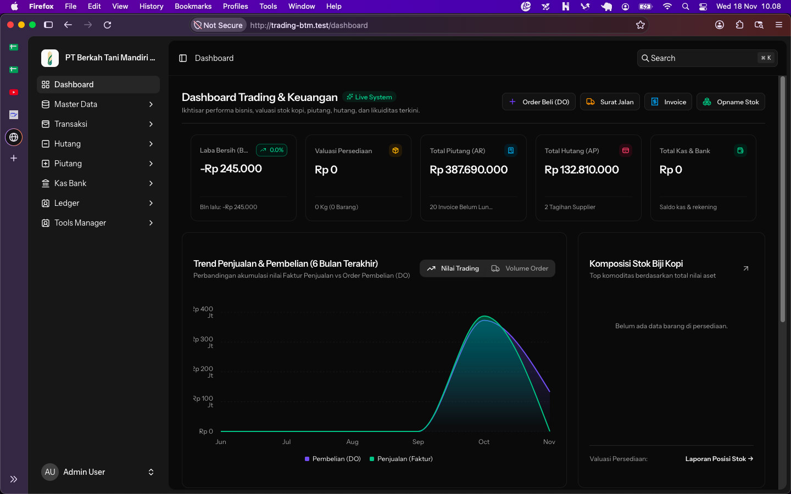

# Sistem Trading & Keuangan Multi-Tenant

Sistem multi-tenant untuk mengelola operasional trading dan aktivitas keuangan, mulai dari transaksi sehari-hari hingga laporan neraca dan laba rugi.

## Pekerjaan yang dilakukan

Sistem ini menghubungkan operasional trading dengan pengelolaan keuangan. Saya mengerjakan perhitungan pembayaran faktur, piutang dan utang, koreksi pelunasan, serta laporan kas dan bank. Laporan mencakup saldo awal dan saldo berjalan, filter tanggal dan akun, serta ekspor PDF atau spreadsheet.

Aplikasi menggunakan Laravel, React, dan TypeScript. Model multi-tenant mendukung penggunaan oleh beberapa organisasi.

## Tampilan dashboard

Dashboard menyatukan ringkasan keuangan, nilai persediaan, serta tren penjualan dan pembelian dalam satu tampilan.

## Kunjungi aplikasi

[Buka aplikasi MTI](https://mti.tako.co.id/login). Aplikasi di-host sendiri pada server pribadi perusahaan dan memerlukan login; kode sumber bersifat privat.
