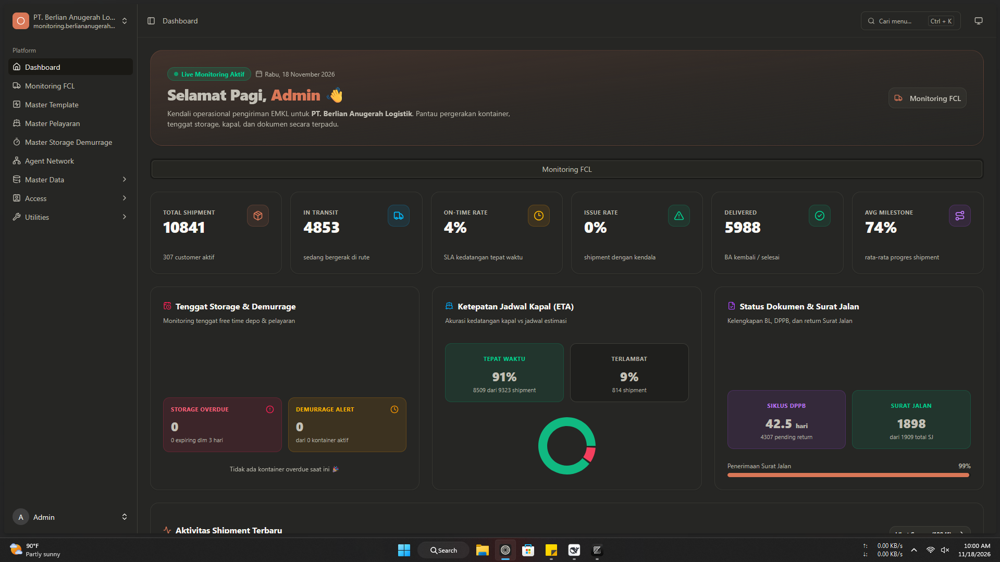
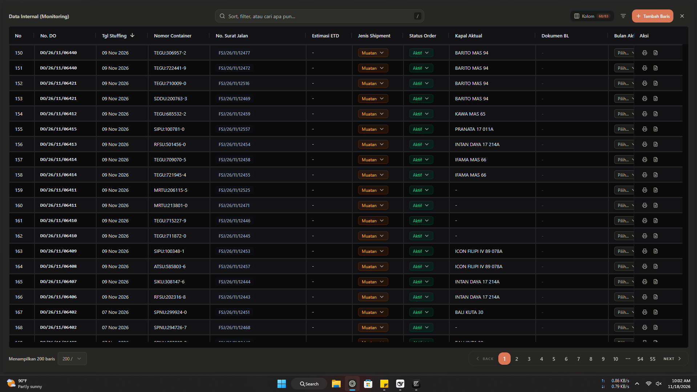

# Monitoring Logistik Multi-Tenant

Aplikasi multi-tenant yang menyatukan data logistik dari berbagai bagian agar informasi dapat diterima secara real-time.

## Masalah utamanya

Staf customer service, marketing, operasional, dan dokumen memiliki catatan Excel masing-masing. Karena dikelola secara terpisah, sinkronisasi informasi antarbagian sering terlambat dan rawan kesalahan. Akibatnya, setiap bagian bisa bekerja dengan versi informasi yang berbeda.

## Pendekatannya

Aplikasi monitoring menyatukan data yang digunakan dalam pekerjaan setiap bagian ke dalam satu platform. Saat informasi diperbarui, bagian lain dapat menerimanya secara real-time tanpa menunggu sinkronisasi spreadsheet yang terpisah.

## Berbagi data antarperusahaan

Beberapa perusahaan menggunakan platform ini sebagai tenant dan dapat berbagi data satu sama lain. Dengan begitu, informasi logistik dapat mengalir antarperusahaan, selain antarbagian di dalam masing-masing perusahaan.

Aplikasi menggunakan Laravel dan React, dengan Go untuk microservice.

## Tampilan aplikasi

Dashboard menyatukan progres pengiriman, jadwal kapal, tenggat penyimpanan, dan status dokumen dalam satu tampilan.

Tabel monitoring menyatukan catatan operasional agar tim dapat mencari, memfilter, dan memperbarui data.

## Kunjungi aplikasi

[Buka Monitoring Logistik](https://monitoring.tako.co.id/). Aplikasi di-host sendiri pada server pribadi perusahaan dan memerlukan login; kode sumber bersifat privat.
