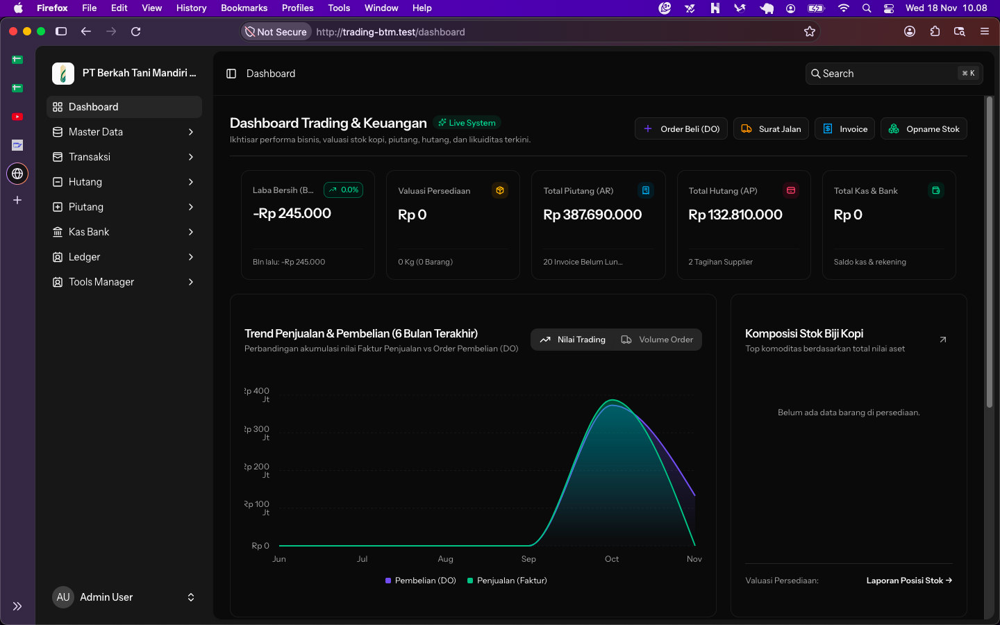

# Multi-Tenant Trading & Finance System

A multi-tenant system for managing trading operations and financial activity, from day-to-day transactions through to balance sheets and profit-and-loss reports.

## The work

The system connects trading operations with financial management. I worked on invoice payment calculations, receivables and payables, settlement corrections, and cash and bank reporting. Reports include opening and running balances, date and account filters, and PDF or spreadsheet exports.

The application uses Laravel, React, and TypeScript. Its multi-tenant model supports multiple organizations.

## Application dashboard

The dashboard brings financial summaries, inventory value, and sales and purchase trends together in one view.

## Visit the application

[Open the MTI application](https://mti.tako.co.id/login). The application is self-hosted on a private company server and requires a login; the source code is private.
