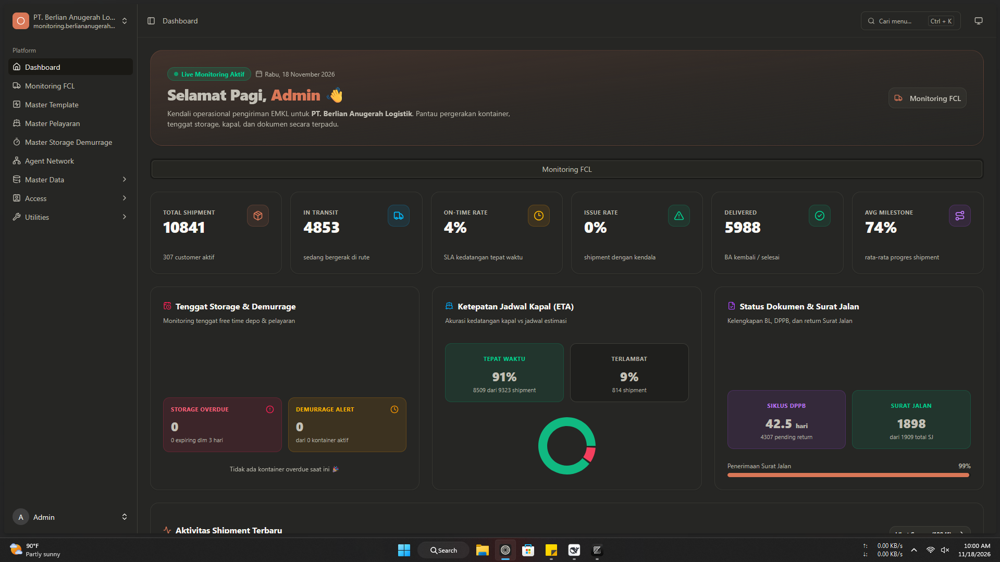
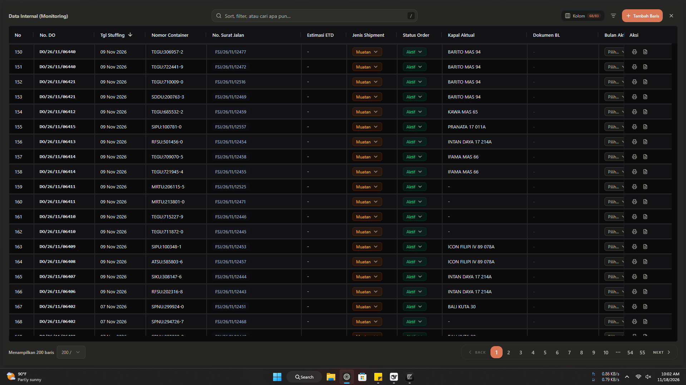

# Multi-Tenant Logistics Monitoring

A multi-tenant application that brings logistics data from different teams into one place, so they can receive updates in real time.

## The problem to solve

Customer service, marketing, operations, and documentation staff each kept their own records in Excel. Because those files were maintained separately, synchronizing information between teams could be slow and prone to mistakes. People could be working from different versions of the same information.

## The approach

The monitoring application brings the data used in each team's work into a central platform. When information is updated, teams can receive it in real time instead of waiting for separate spreadsheets to be synchronized.

## Multi-tenant data sharing

Multiple companies use the platform as tenants, and can also share data with one another. This allows logistics information to flow between companies as well as between teams within each company.

Laravel and React power the application, with Go used for microservices.

## Application screens

The dashboard brings shipment progress, vessel schedules, storage deadlines, and document status into one view.

The monitoring table brings operational records together for teams to search, filter, and update.

## Visit the application

[Open Logistics Monitoring](https://monitoring.tako.co.id/). The application is self-hosted on a private company server and requires a login; the source code is private.
